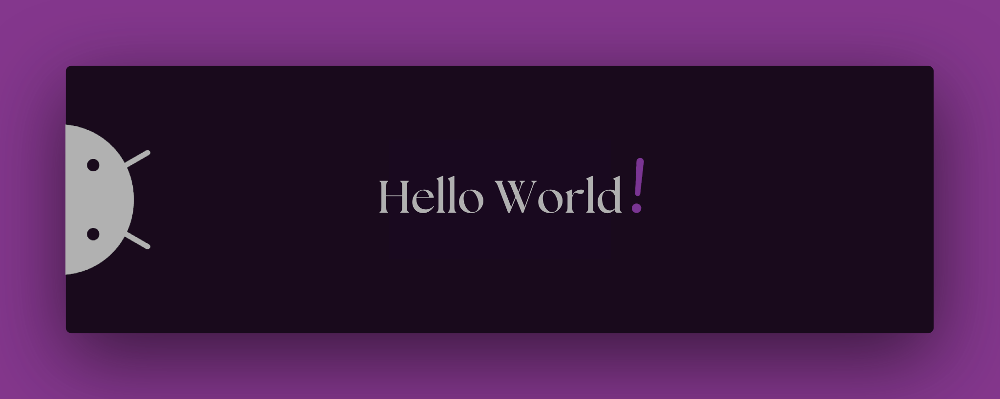
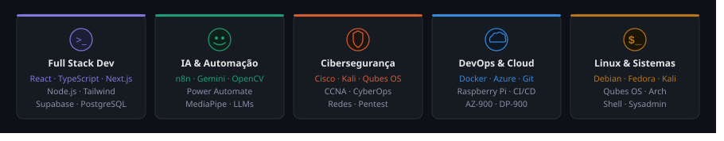
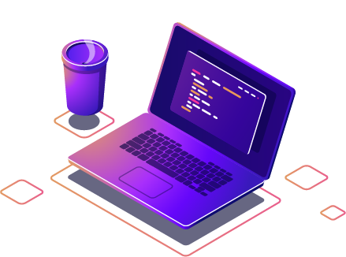
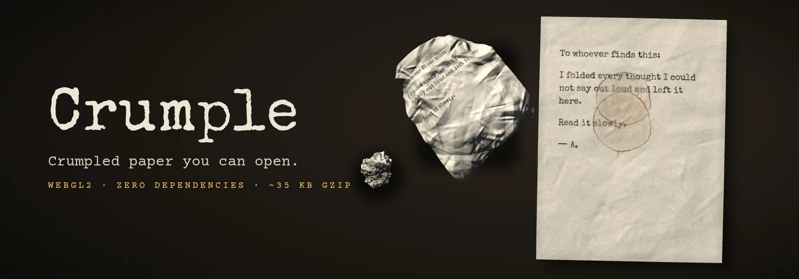
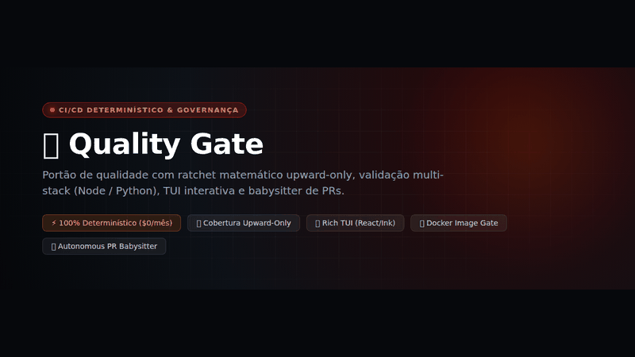
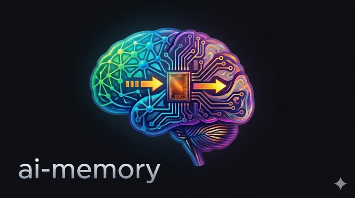
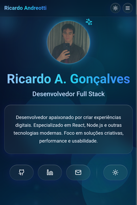
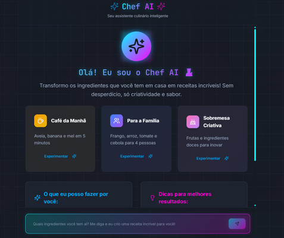

<!-- ============================================ -->
<!-- HEADER: TYPING ANIMADO + WAVE                -->
<!-- ============================================ -->

<div align="center">

[](https://git.io/typing-svg)


</div>

<!-- ============================================ -->
<!-- BANNER PRINCIPAL                             -->
<!-- ============================================ -->

<div align="center">
  
</div>

<br>

<!-- ============================================ -->
<!-- BADGES DE CONTATO                            -->
<!-- ============================================ -->

<div align="center">

[](https://www.linkedin.com/in/ricardo-andreotti)
[](https://github.com/devAndreotti)
[](https://devandreotti.com/)
[](mailto:devandreotti@gmail.com)
[](https://wa.me/5515981888676)
[](https://www.instagram.com/ricardo.agonc)

</div>

<br>

<!-- ============================================ -->
<!-- SOBRE MIM: BIO + MÉTRICAS                    -->
<!-- ============================================ -->

## 💫 Sobre Mim

```javascript
const ricardo = {
    foco:        ["Full Stack", "IA & Automação", "Cybersecurity", "Blockchain"],
    formação:    "Ciência da Computação (7º semestre)",
    tcc:         "RAG aplicado a notas Obsidian e documentos corporativos",
    localização: "Sorocaba, SP 🇧🇷",
    universidade: "UNIP",
    estudando:   ["AI orchestration", "Ruby on Rails", "software architecture", "english"],
    hobbies:     ["Coding", "Chess", "Linux"],
    email:       "devandreotti@gmail.com",
    status:      "Always building something cool"
};
```

<br clear="right"/>

<p align="center">
  
  
</p>

<br>

<!-- ============================================ -->
<!-- ÁREAS DE INTERESSE: SVG                      -->
<!-- ============================================ -->

## 🎯 Áreas de Interesse

<div align="center">
  
</div>

<br>

<!-- ============================================ -->
<!-- STACK TÉCNICO: DROPDOWNS POR CATEGORIA       -->
<!-- ============================================ -->

## 🛠️ Stack Técnico

<details>
<summary><b>🎨 Front-End</b></summary>
<br>


</details>

<details>
<summary><b>⚙️ Back-End & Databases</b></summary>
<br>


</details>



<details>
<summary><b>🤖 Automação & IA</b></summary>
<br>


</details>

<details>
<summary><b>⛓️ Blockchain & Web3</b></summary>
<br>


</details>

<details>
<summary><b>🐳 DevOps & Cloud</b></summary>
<br>


</details>

<details>
<summary><b>🐧 Linux & Sistemas Operacionais</b></summary>
<br>


</details>

<details>
<summary><b>🔐 Cibersegurança & Dados</b></summary>
<br>


</details>

<br>

<div align="center">
  
</div>

<!-- ============================================ -->
<!-- GRÁFICO DE CONTRIBUIÇÕES + TROPHIES          -->
<!-- ============================================ -->

<div align="center">
<a href="https://github.com/devAndreotti">
  
</a>
</div>

<br>

<!-- ============================================ -->
<!-- CERTIFICAÇÕES & CURSOS POR CATEGORIA         -->
<!-- ============================================ -->

## 📚 Certificações & Cursos

<details>
<summary><b>🤖 IA & Automação (2 certificações)</b></summary>
<br>


</details>


<details>
<summary><b>🐧 Linux (1 certificação)</b></summary>
<br>


</details>

<details>
<summary><b>🔐 Cibersegurança (3 certificações)</b></summary>
<br>


</details>

<details>
<summary><b>☁️ Cloud & Dados (3 certificações)</b></summary>
<br>


</details>

<details>
<summary><b>⛓️ Blockchain (1 certificação)</b></summary>
<br>


</details>

<details>
<summary><b>🛤️ Em Andamento</b></summary>
<br>


</details>

<br>

<!-- ============================================ -->
<!-- PROJETOS EM DESTAQUE: GRID 2x3               -->
<!-- ============================================ -->

## 🚀 Projetos em Destaque

<div align="center">
<table>
<tr>

<td width="50%" valign="top">

<a href="https://github.com/devAndreotti/crumple">
  
</a>

### 📄 Crumple · Biblioteca WebGL2
[](https://www.npmjs.com/package/@devandreotti/crumple)
[](https://devandreotti.github.io/crumple/)

Biblioteca WebGL2 procedural e zero-dependências (~35 KB gzip) que simula papel amassado em 3D e desdobramento físico interativo com vincos, sombras dinâmicas, tintas e presets customizáveis (blueprint, punchcard, ledger).


</td>

<td width="50%" valign="top">

<a href="https://devandreotti.com/">
  
</a>

### 🏢 Memory Apartment
[](https://devandreotti.com/)
[](https://devandreotti.com/)

Jogo 3D de terror psicológico retrô (anos 2000) com arquitetura impossível não-euclidiana, sistemas diegéticos (PC Windows XP, câmera flip, TV CRT) e portão de regressão automatizado no Godot 4.


</td>

</tr>
<tr>

<td width="50%" valign="top">

<a href="https://github.com/devAndreotti/quality-gate">
  
</a>

### 🛡️ Quality Gate · CI/CD Determinístico
[](https://github.com/devAndreotti/quality-gate)
[](https://github.com/devAndreotti/quality-gate)

Portão de qualidade determinístico com ratchet matemático upward-only (impede queda de cobertura de testes), auditoria multi-stack via AST, verificação estática de containers Docker e babysitter autônomo de PRs.


</td>

<td width="50%" valign="top">

<a href="https://github.com/devAndreotti/ai-memory">
  
</a>

### 🧠 AI-Memory · Memória para Agentes
[](https://github.com/devAndreotti/ai-memory)
[](https://github.com/akitaonrails/ai-memory)

Fork do ai-memory de Fabio Akita (akitaonrails). Servidor MCP de alto desempenho em Rust para persistência e recuperação de contexto durável entre agentes autônomos de código, viabilizando handoffs sem perda arquitetural.


</td>

</tr>
<tr>

<td width="50%" valign="top">

<a href="https://devandreotti.com/">
  
</a>

### ❄️ Frosted Motion Folio
[](https://devandreotti.com/)
[](https://github.com/devAndreotti/frosted-motion-folio-v2)

Portfólio interativo com estética de vidro fosco, Three.js sob demanda com hardware 3D interativo, blog bilíngue sincronizado, gerador de currículo ATS nativo em PDF e rotas na Cloudflare Edge.


</td>

<td width="50%" valign="top">

<a href="https://github.com/devAndreotti/chef-ai">
  
</a>

### 👨‍🍳 Chef AI · Agente com IA & n8n
[](https://github.com/devAndreotti/chef-ai)
[](https://github.com/devAndreotti/chef-ai)

Agente inteligente que recebe ingredientes via webhook, orquestra fluxos autônomos no n8n processados pelo Google Gemini Flash e retorna receitas personalizadas numa interface moderna e reativa.


</td>

</tr>
</table>
</div>

<br>

<!-- ============================================ -->
<!-- GITHUB STATS: CARDS + STREAK + TEMPO         -->
<!-- ============================================ -->

## 📈 GitHub Stats & Linguagens

<a href="https://github.com/devAndreotti">
  
  
</a>

<br>

## 🔥 GitHub Streak & Tempo Produtivo

<a href="https://github.com/devAndreotti">
  
  
</a>

<br>

<!-- ============================================ -->
<!-- SNAKE DE CONTRIBUIÇÕES (GitHub Actions)      -->
<!-- ============================================ -->

## 🐍 Snake Contribution

<div align="center">

<picture>
  <source media="(prefers-color-scheme: dark)"  srcset="https://raw.githubusercontent.com/devAndreotti/devAndreotti/output/github-snake-dark.svg" />
  <source media="(prefers-color-scheme: light)" srcset="https://raw.githubusercontent.com/devAndreotti/devAndreotti/output/github-snake.svg" />
  
</picture>

</div>

<!-- ============================================ -->
<!-- FOOTER                                       -->
<!-- ============================================ -->

<div align="center">

<br><br>


[](https://buymeacoffee.com/ricardo230a)


</div>
